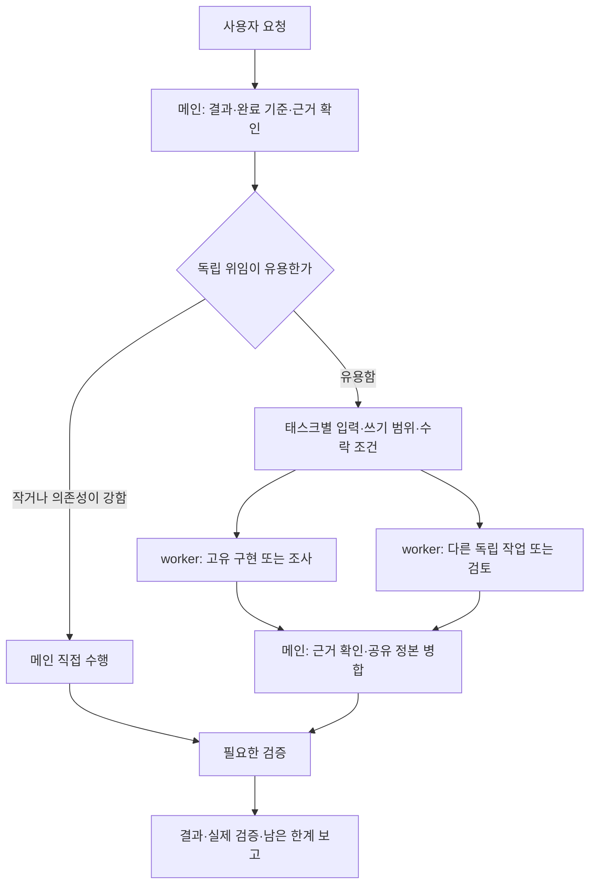

# 공통 지침·태스크 분담 검토 및 개정 — 2026-10-26

## 판단

기존 지침은 작업 규모와 무관하게 승인 대기, 분석 저장, 로그·대장, 검증기·음성 대조, 정해진 형식과 폴더를 같은 직렬 절차로 요구했다. 작은 수정에도 왕복과 산출물이 늘고, 일부 지침이 서로 충돌할 위험이 있었다. 이를 기본 경량 작업과 선택형 추적으로 분리했다.

이 평가는 문서·의존성의 정적 검토다. 모델의 처리 속도·토큰 소비·정답률·실제 병렬 가속을 비교 측정하지 않았다. 아래 줄 수·문자 수 감소는 파일 크기 측정이며 성능 측정치가 아니다.

## 발견과 조치

| 기존 제약 | 영향 | 반영 |
|---|---|---|
| 출력 전 무조건 분석 공유·승인 대기 | 이미 허용된 수정도 불필요하게 중단 | 기존 승인 범위에서 진행, 실제 추가 권한·필수 결정만 질문 |
| PROJECT_RULES 부재 시 실질 작업 중단 | 단순 요청에도 프로젝트 설문·파일 생성 | 기존 근거 탐색 우선, 결과에 필요한 미확정 사항만 질문 |
| 모든 분석·응답·파일을 보존하고 append마다 전체 검사 | 조율·기록량 증가, 병렬 로그 충돌 | lightweight 기본, tracked가 필요할 때 작업 단위 기록·마감 검사 |
| 표는 DOCX, 도식은 HTML, 폴더 위치 일괄 강제 | 사용자 요청·기존 정본과 충돌 | 요청 형식·실제 정본 우선, Markdown 표·Mermaid 허용 |
| 모든 수정은 음성 대조+CI, 모든 코드 언급은 원문 인용 | 문구·서식 변경에도 과도한 검증 | 변경 위험에 맞춘 확인, 재현 가능한 버그는 회귀 검사 우선 |
| 고정 3-agent, 역할·계획 파일 없으면 중단 | 위임 이점 없는 태스크까지 준비 비용 | 메인 직접 실행 또는 필요한 독립 태스크만 위임, 파일은 장기 인계에 선택 |
| 메인 중간 개입 금지·특정 Agent 도구 가정 | 현재 런타임 기능·조정 책임과 불일치 | 현재 도구 사용, 메인 조정·통합·검증 유지 |
| GPU·물리·RAG가 같은 domain_metrics.md에 직접 쓰기 | 공유 workspace 덮어쓰기·append 충돌 | worker별 조각/메시지 반환, 메인 단일 병합 |
| 부분 실패 worker의 모든 결과를 차단 | 독립적으로 수락된 결과도 불필요하게 대기 | 수락되지 않은 필수 입력의 의존 작업만 보류 |
| 변경마다 고정 관점 재감사·새 코드면 처음부터 반복 | 재검토 범위·시간이 확대 | 검토 기준점·가용 슬롯·예산 지정, 채택 변경과 추가 diff만 재확인 |

기존 최소 변경, 사용자 편집 보존, 실제 근거, 권한 경계, 필요한 검증과 미해결 공개는 유지했다. 기존 프로젝트가 정한 필수 승인·검증 주기·상태 의미론·스키마는 신규 기본값으로 자동 완화하지 않는다.

## 파일 구성

- [GLOBAL_RULES.md](../templates/project/GLOBAL_RULES.md): 일상 공통 지침.
- [TRACEABILITY.md](../templates/project/policies/TRACEABILITY.md): 명시한 tracked 또는 기존 필수 추적 프로젝트에서만 적용.
- [프로젝트 시작 안내](../templates/project/README.md), [PROJECT_RULES 골격](../templates/project/PROJECT_RULES.template.md), [AGENTS 진입점](../templates/project/AGENTS.md): 새 프로젝트에 복사하거나 기존 파일에 병합.
- [저장소 agents.md](../agents.md): 짧은 라우팅 지침. 기존 상세 manifest는 [선택형 참조](../skills/agent_orchestration/agent-orchestration/references/engineering-manifest.md)로 분리.
- [역할 설계](../skills/agent_orchestration/agent-orchestration/SKILL.md)와 [실행·통합](../skills/agent_orchestration/agent-executor/SKILL.md): 실제 태스크 분해·핸드오프·복구 계약.
- [context-engineering](../skills/engineering_pipeline/context-engineering/SKILL.md): 환경 탐색·요청된 설정만 병합, 키 값 저장·필수 질문·자동 새 채팅 지시 제거.
- 기존 엔지니어링 입력 경로·매뉴얼의 폐지된 Rule 번호, 도메인 감사 공유 출력, Delta 검토 지침도 동기화했다.

과거 원문은 [아카이브](../archive/global-rules-2026-10-26/README.md)에 보존했다. 다른 프로젝트에 설치된 규칙은 일괄 덮어쓰지 않았다.

## 메인·서브에이전트 운영

메인은 결과와 완료 기준을 정한 뒤 조율비용보다 독립 작업의 가치가 큰 경우만 위임한다. Architect/Builder/Verifier는 역할 예시이며 필수 인원수가 아니다.

위임 계약은 목표, 실제 입력·기준점, 출력 또는 반환, 선행 수락 조건, 고유 쓰기 범위, 완료 검사와 기존 권한을 포함한다. 짧은 위임은 메시지로 충분하며 장기 재개가 필요하면 역할·계획 템플릿을 쓴다.

같은 파일의 writer는 한 명이다. 메인이 공유 ID·로그·대장·통합 파일을 조정하고, worker가 종료되기 전에는 미위임 critical path 작업을 진행한다. 인원은 메인 포함 런타임 한도를 따르며 추가 fanout으로 한도를 우회하지 않는다. worker의 PASS는 실제 출력·검사·수락 기준을 확인한 뒤 반영한다.

## 정적 시나리오 검토

독립 검토자는 다음 7개 시나리오의 지침상 기대 행동을 확인했고 지적된 문구와 설치 경로를 수정 후 재확인했다. 이는 에이전트 실행 벤치마크가 아니다.

| 시나리오 | 기대 행동 |
|---|---|
| 단순 수정 | 메인 직접, 관련 확인, 추가 승인·태스크 파일 없음 |
| 분리 가능한 기능 | 고유 범위로 위임, 공통 계약과 통합은 메인 |
| 문서 작성 | 요청 형식·기존 정본 우선, 독립 조사만 중첩 |
| 고위험 변경 | 실제 권한·필수 검사 유지, 검토 가능한 결과 준비 |
| 정보 부족 | 근거 조사 후 필요한 질문만, 독립 작업 계속 |
| 공유 정본 충돌 | worker별 조각 반환, 단일 소유자 병합 |
| 기존 tracked 프로젝트 | 기존 필수 통제·이력·스키마 우선 |

## 측정과 확인

| 지침 | 이전 줄 수 | 현재 줄 수 | 문자 수 감소 |
|---|---:|---:|---:|
| GLOBAL_RULES.md | 250 | 44 | 72.2% |
| 저장소 agents.md | 741 | 25 | 91.9% |
| agent-orchestration SKILL | 129 | 26 | 61.8% |
| agent-executor SKILL | 132 | 28 | 66.3% |
| context-engineering SKILL | 199 | 37 | 63.9% |

상세 추적 규약과 engineering manifest는 삭제하지 않고 선택 로딩으로 분리했다. 전체 파일을 모두 읽는 모드의 성능을 위 수치로 추정하지 않는다.

- 설치기 회귀 9개 통과. 새 orchestration 설치의 필수 리소스·평탄화된 링크 확인.
- 원본 주요 지침·매뉴얼·참조 링크 97개: 누락 0. 설치본의 관련 3개 SKILL은 정본 hash와 일치, 독립 검사 링크 18개 누락 0.
- 로그 v2 합성 검사 4개(정상, 요청 누락, 검증 공란, 와일드카드)와 graph checker 3개(정상 인용, 깨진 인용, 등록된 미해결) 통과. 기존 스키마·검사 기능은 바꾸지 않았다.
- 스킬 정본 36개는 유지. Codex strict 메타데이터 검사 22개 통과, 기존 Claude용 user-invocable 필드가 남은 14개는 그 호환성 제한으로 별도 기록.
- 앞선 문서 스킬 통합·검증 결과는 [기존 보고서](document-skill-consolidation-2026-10-25.md)를 유지했다. 이번에는 문서 실행기·Office 보호 동작을 변경하지 않았다.

전체 정본·템플릿·문서 링크 322개도 검사했으며, 생성될 형제 문서 2개와 원래 없는 그림을 시험하는 fixture 1개를 제외한 운영 리소스 누락은 없었다.

검증 원문은 세션 산출물의 rules-review-2026-10-26/에 보존했다. 실제 처리 속도·품질 개선 여부는 동일 모델·환경·작업 묶음으로 별도 비교해야 하며, 이번 작업은 그러한 측정을 수행하지 않았다.
